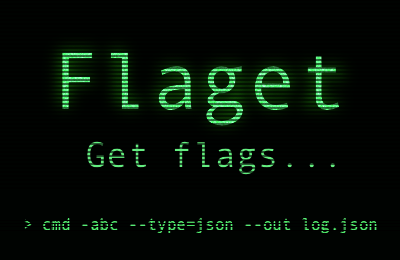

<h1 align="center">
  
</h1>

Tiny CLI flag/argument parser.
Supports all standard CLI flag formats.

## Features

- Short `-f` and long `--flag` flags
- Grouped short boolean flags `-xyz`
- Values via `--key=value`, `--key value`, `-k=value` or `-k value`
- Negative numbers as values `--offset -5`
- Multi-value flags via `array` option
- Negated flags `--no-color`
- Boolean-only flags via `boolean` option
- Text values via `string` option, kept as written `--zip=01234`
- POSIX short flags with value `-xvf archive.tar`, `-n5` for flags in `string` option
- Named and variadic (`...rest`) positional arguments via `args` option
- Short-to-long mapping via `alias` option
- Auto-casts numbers and booleans from values
- Default values via `default` option
- Dashed keys also available as camelCase
- Captures arguments before and after `--` terminator

See [full documentation](https://github.com/webdiscus/flaget).
